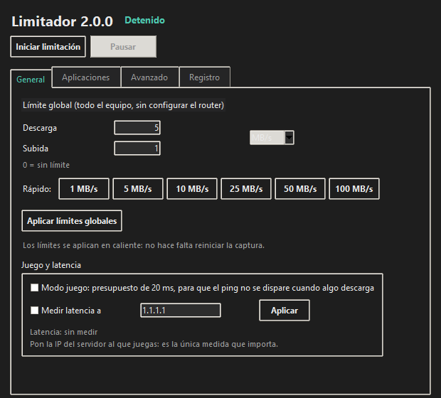
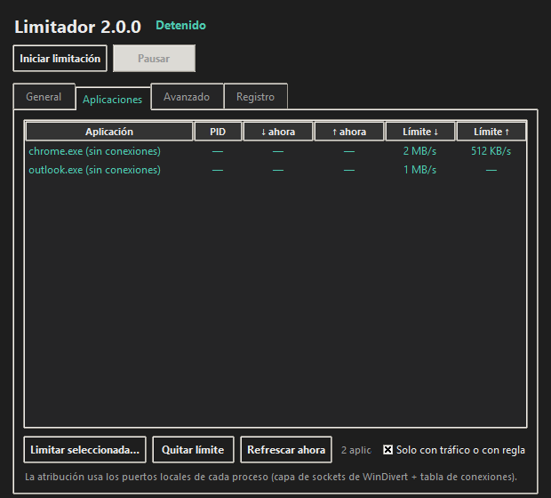
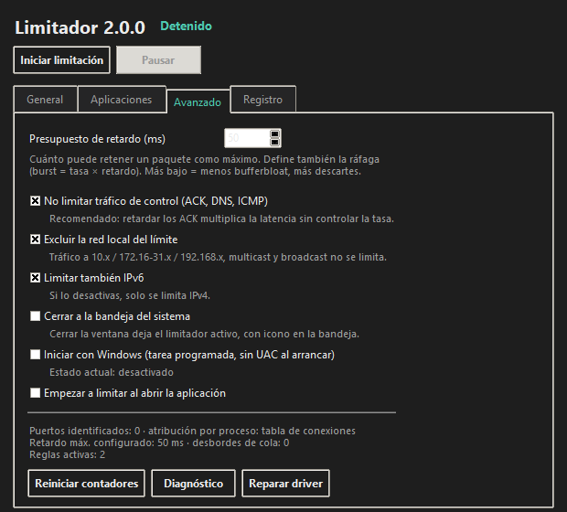
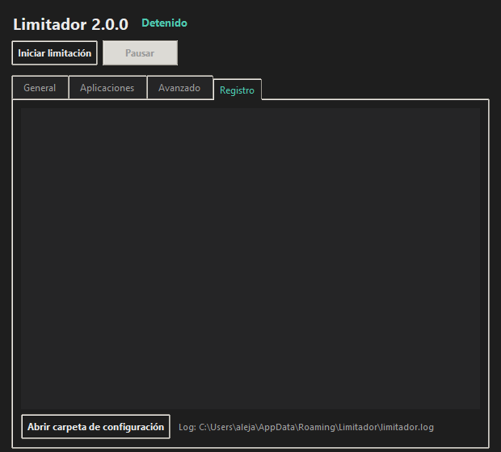

# Limitador

> Limitador de ancho de banda para Windows: **por aplicación** o para **todo el equipo**.
> Una alternativa simple, libre y gratuita a NetLimiter. Sin tocar el router, sin drivers
> propios firmados, sin cuentas ni telemetría.


**¿Quieres verlo funcionando?** → [DEMO.md](DEMO.md): guion de 3 minutos con mediciones reales.

---

## Qué hace

- **Límite por aplicación**: limita la bajada/subida de un programa concreto (Chrome, Steam,
  un backup…) y deja el resto del equipo sin tocar.
- **Límite global**: limita todo el tráfico del equipo de una vez.
- **Monitor en vivo**: qué aplicaciones están usando la red y a qué velocidad, en MB/s.
- **Latencia controlada (AQM)**: no llena la cola del enlace; el retardo añadido está acotado
  por un presupuesto configurable (50 ms por defecto) en lugar de provocar *bufferbloat*.
- **Reglas persistentes**: las reglas por aplicación se guardan y se aplican solas.
- **Bandeja del sistema, inicio con Windows (sin UAC), modo consola, diagnóstico.**

### Verificado en hardware real

Prueba de aceptación automatizada (`tools/acceptance_test.py`) sobre una línea de 27 MB/s:

| Fase | Resultado |
|------|-----------|
| Captura activa sin límites | petición HTTP 200 en 0,68 s, tráfico reinyectado al 100 % |
| Línea sin límite (referencia) | 27,36 MB/s |
| Límite global de 9,12 MB/s | **8,84 MB/s (97 % del objetivo)** |
| Límite solo a `curl.exe` de 9,12 MB/s | **8,40 MB/s (92 % del objetivo)** |
| Descartado por AQM / captura liberada por seguridad | 5,16 MB / no |

Precisión del planificador medida en tiempo real (`tools/pacing_check.py`):
30 MB/s → 100,0 %, 10 MB/s → 100,0 %, 3 MB/s → 100,0 %, 0,5 MB/s → 100,2 %.

Para repetirlo en tu equipo: `tools\demo.cmd` (tres mediciones reales, pide UAC una vez) o
`tools\run_elevated.ps1` (prueba completa, fases 0-3).

### La interfaz

Capturas generadas por la propia aplicación (`Limitador.exe --screenshot docs\img --demo`):

| General | Aplicaciones |
|---------|--------------|
|  |  |
| Límite de todo el equipo, en caliente | Qué app consume qué, y su límite propio |

| Avanzado | Registro |
|----------|----------|
|  |  |
| Retardo, tráfico de control, IPv6, bandeja, inicio | Todo lo que hace el motor, en texto |

*(En las capturas se usan límites de ejemplo en memoria para que se vea la interfaz en uso.)*

---

## Instalación (usuario final)

En la página de [Releases](../../releases/latest) hay dos opciones:

### Opción 1 · Instalador (recomendado)

1. Descarga `Setup_Limitador_2.0.0.exe`.
2. Doble clic y sigue el asistente (pide permisos de administrador: los necesita el driver).
3. Acceso directo en el escritorio y en el menú Inicio.
4. Opcional: marca «Iniciar Limitador automáticamente con Windows» (tarea programada con
   privilegios altos, sin aviso de UAC en cada arranque).

### Opción 2 · Portable

1. Descarga `Limitador.exe` (≈20 MB).
2. Cópialo donde quieras (USB, carpeta personal…).
3. Doble clic: la app pide elevación ella misma cuando la necesita.

No hace falta Python ni nada extra: el driver WinDivert viaja dentro del ejecutable y se
instala en `%ProgramData%\Limitador\driver` la primera vez.

> **Si Windows muestra «Windows protegió tu PC» (SmartScreen)**: el programa no está firmado
> digitalmente (un certificado de firma de código cuesta dinero). Pulsa **Más información →
> Ejecutar de todas formas**. Es el mismo aviso que dan todas las aplicaciones libres sin
> firmar; el código está completo en este repositorio y el driver es WinDivert, el mismo que
> usan Wireshark o GlassWire.
>
> Algunos antivirus marcan el ejecutable o el driver (falso positivo típico con WinDivert):
> añade una exclusión para `Limitador.exe` y `%ProgramData%\Limitador\driver`.

---

## Uso

1. Abre Limitador y acepta el aviso de UAC (solo la primera vez de cada ejecución).
2. Pulsa **Iniciar limitación**.
3. Pestaña **General**: define el límite de todo el equipo (bajada/subida). `0` = sin límite.
   Hay botones rápidos (1/5/10/25/50/100 MB/s).
4. Pestaña **Aplicaciones**: lista en vivo de las apps con conexiones. Selecciona una y pulsa
   **Limitar seleccionada…** para darle su propio límite de bajada/subida.
5. Pestaña **Avanzado**: presupuesto de retardo, no limitar tráfico de control (ACK/DNS/ICMP),
   excluir la red local, limitar IPv6, cerrar a la bandeja, inicio con Windows.
6. Cerrar la ventana (con la bandeja activada) deja el limitador funcionando en segundo plano.

Los límites se aplican **en caliente**: no hay que reiniciar la captura para cambiarlos.

### Modo consola

Útil para scripts, servidores o para comprobar que todo funciona:

```bat
Limitador.exe --cli --check                 :: diagnóstico completo (no limita nada)
Limitador.exe --cli --list-apps             :: qué apps usan la red ahora mismo
Limitador.exe --cli --down 5 --up 1 --duration 30
Limitador.exe --cli --app "C:\Program Files\App\app.exe=2:0.5" --duration 60
Limitador.exe --cli --down 5 --json informe.json     :: informe en JSON
Limitador.exe --repair-driver               :: reinstala el driver (necesita admin)
```

En modo consola imprime la velocidad conseguida frente al objetivo, la cola pendiente y los
bytes descartados, y termina con un resumen (media, pico, % del objetivo, descartes).

---

## Cómo funciona

| Componente | Papel |
|------------|-------|
| **WinDivert 2.2.2** (vía `pydivert` 4) | Intercepta paquetes IPv4/IPv6 a nivel de kernel |
| **Planificador por fecha de salida** | Calcula cuándo puede salir cada paquete (`depart = max(ahora, anterior) + tamaño/tasa`) |
| **AQM con presupuesto de retardo** | Descarta el sobrante cuando la cola supera `tasa × retardo_máx` (y **nunca** descarta en un enlace ocioso) |
| **Atribución puerto → proceso** | Tabla de conexiones TCP/UDP (y capa de sockets de WinDivert cuando el build la soporta) |
| **Filtros validados** | El filtro se compila con el compilador de WinDivert antes de capturar nada |
| **Fail-open** | Si un hilo del motor muere, la captura se libera automáticamente para no dejar sin internet |

El diseño completo, con las decisiones y las trampas encontradas, está en
[docs/ARQUITECTURA.md](docs/ARQUITECTURA.md).

### Limitaciones conocidas (honestas)

- **Solo Windows 10/11 x64.** El driver y la API de atribución de procesos son de Windows.
- **El tráfico de la red local no se limita** (10.x, 172.16-31.x, 192.168.x, multicast,
  broadcast): es deliberado, para no romper la red de casa. Se puede desactivar en Avanzado.
- **La capa de sockets de WinDivert no está disponible en este equipo** (el driver devuelve
  error 87 al abrirla), así que la atribución por proceso usa la tabla de conexiones, que se
  refresca cada segundo. Consecuencia práctica: un flujo recién abierto puede tardar hasta
  ~1 s en quedar bajo su límite por aplicación. El límite global no se ve afectado.
- **No inspecciona contenido** (no es un firewall ni un filtro de URLs): solo mide y regula tasa.
- Un paquete TCP sin carga (ACK puro), DNS e ICMP no se limitan por defecto: retardarlos sube
  la latencia sin controlar nada. Se puede desactivar en Avanzado.
- No hay límites por «grupo de aplicaciones» ni por interfaz de red (todavía).

---

## Solución de problemas

### El antivirus marca el ejecutable o el driver

Falso positivo habitual con WinDivert. Añade una exclusión para `Limitador.exe` y para
`%ProgramData%\Limitador\driver`.

### «El driver WinDivert no está disponible (error 1058/1060)»

Pulsa **Avanzado → Reparar driver**, o ejecuta `Limitador.exe --repair-driver` como
administrador. Esto reinstala el registro del servicio apuntando a
`%ProgramData%\Limitador\driver`.

### **Me he quedado sin internet** (recuperación de emergencia)

Ocurre solo si el proceso del limitador muere *mientras* tiene paquetes retenidos. Al morir el
proceso, Windows cierra sus descriptores y la red vuelve sola; si aun así no vuelve:

1. **Cierra la ventana de Limitador** (o, si está en la bandeja, botón derecho → *Salir*). Al
   cerrarse, el motor detiene la captura y la red vuelve al instante.
2. Si la ventana no responde: Administrador de tareas **abierto como administrador** (Limitador
   corre elevado, así que un Administrador de tareas normal no puede terminarlo y dirá «Acceso
   denegado») → finalizar `Limitador.exe`.
3. Si nada de lo anterior funciona: `tools\unblock.cmd` con el botón derecho → *Ejecutar como
   administrador* (equivale a `Limitador.exe --cli --unblock`). Elimina el servicio del driver y
   la red vuelve de inmediato.

El motor incluye tres protecciones para que esto no pase: el camino por paquete no puede
lanzar excepciones, un vigilante libera la captura si un hilo se detiene, y la prueba de
aceptación se autodestruye si se pasa de tiempo.

### La velocidad real es menor que el límite configurado

Normal: cabeceras TCP/IP y retransmisiones cuentan como bytes pero no como datos útiles.
Configura el límite un 5-10 % por encima de lo que quieras conseguir. En las pruebas
automatizadas el tráfico limitado sale al 92-97 % del objetivo.

### Latencia alta al limitar

Baja el *presupuesto de retardo* en Avanzado (p. ej. 20-30 ms). Más bajo = menos bufferbloat,
pero también más descartes cuando la aplicación pide más de lo permitido.

### «Iniciar con Windows» no funciona

Comprueba en la pestaña Avanzado que la casilla está marcada y que la tarea existe:

```bat
schtasks /Query /TN Limitador
```

---

## Compilar desde el código

Requisitos: Windows 10/11, Python 3.10+ (o `uv`), y para el instalador Inno Setup 6.x.

```bat
build.bat             :: crea el venv, instala deps, pasa los tests y compila dist\Limitador.exe
build_installer.bat   :: lo anterior + installer_output\Setup_Limitador_2.0.0.exe
```

`build.bat` se niega a empaquetar si alguna prueba está en rojo.

### Desarrollo

```bat
uv venv .venv --python 3.13
uv pip install --python .venv\Scripts\python.exe -r requirements-dev.txt
.venv\Scripts\python.exe -m pytest tests -q          :: 102 pruebas, sin driver ni admin
.venv\Scripts\python.exe -m ruff check .             :: análisis estático (0 avisos)
.venv\Scripts\python.exe -m ruff format --check .    :: formato
.venv\Scripts\python.exe main.py                     :: app en modo desarrollo (auto-eleva)
.venv\Scripts\python.exe main.py --screenshot docs\img --demo   :: capturas de la interfaz
```

El mismo control corre en cada push mediante GitHub Actions (`.github/workflows/ci.yml`):
ruff, las 102 pruebas, el ejecutable y el instalador.

### Herramientas de verificación

| Herramienta | Qué hace | Necesita admin |
|-------------|----------|----------------|
| `tools\demo.cmd` | Demostración guiada: 3 mediciones reales (referencia, global, por aplicación) | Pide UAC |
| `tools\pacing_check.py` | Precisión del planificador en tiempo real | No |
| `tools\acceptance_test.py` | Prueba de aceptación completa en la red real (fases 0-3) | Sí |
| `tools\run_elevated.ps1` | Lanza cualquier script de `tools\` con UAC y lo mata si se pasa de tiempo | Pide UAC |
| `tools\live_check.ps1` | Limitador en consola + tráfico real, para diagnóstico en vivo | Pide UAC |
| `tools\unblock.cmd` | Recuperación de emergencia de la red | Sí |

Y desde el propio ejecutable:

```bat
Limitador.exe --screenshot docs\img --demo   :: captura cada pestaña (documentación/verificación)
```

---

## Estructura del proyecto

```
Internet_Limiter/
├── limitador/
│   ├── engine.py       # captura WinDivert + hilos de inyección + vigilante
│   ├── shaper.py       # planificador de tasa (fecha de salida) + AQM + medidores
│   ├── classify.py     # lectura rápida de cabeceras, decisión por paquete, autotest
│   ├── procmap.py      # atribución puerto local -> proceso
│   ├── filters.py      # construcción y validación de filtros WinDivert
│   ├── driver.py       # instalación estable del driver, reparación, diagnóstico
│   ├── rules.py        # configuración y reglas por aplicación (JSON)
│   ├── gui.py          # interfaz Tkinter + bandeja del sistema
│   ├── cli.py          # modo consola con medición
│   ├── app.py          # arranque: logging, instancia única, elevación
│   ├── autostart.py    # tarea programada de inicio
│   └── units.py, console.py
├── tests/              # 102 pruebas (planificador, filtros, clasificación, motor con handle falso)
├── tools/              # demo guiada, verificación y recuperación
├── docs/               # arquitectura, auditoría de la v1, capturas de la interfaz (img/)
├── .github/workflows/  # integración continua: ruff + pruebas + ejecutable + instalador
├── DEMO.md             # guion de demostración (3 minutos)
├── main.py             # punto de entrada
├── Limitador.spec      # receta de PyInstaller
├── pyproject.toml      # configuración de ruff y pytest
├── build.bat / build_installer.bat / installer.iss
└── requirements.txt / requirements-dev.txt
```

---

## Historia

La versión 1.0.0 **no limitaba nada**: el filtro de captura no compilaba (usaba
`not (... )`, que el lenguaje de filtros de WinDivert no acepta) y, además, su lógica de
exclusión de LAN era incorrecta, de modo que habría descartado todo el tráfico. El fallo se
confundía con un «servicio deshabilitado». El análisis completo, con las pruebas que lo
demuestran, está en [docs/AUDITORIA_v1.md](docs/AUDITORIA_v1.md). La 2.0.0 es una reescritura
del motor, verificada en red real.

## Licencia

[Apache License 2.0](LICENSE). Terceros: ver [THIRD_PARTY_NOTICES.md](THIRD_PARTY_NOTICES.md)
(WinDivert es LGPL v3).

## Créditos

- [WinDivert](https://reqrypt.org/windivert.html) — driver de captura de paquetes.
- [pydivert](https://github.com/ffalcinelli/pydivert) — bindings de Python.
- [PyInstaller](https://pyinstaller.org/) — empaquetado.
- [Inno Setup](https://jrsoftware.org/isinfo.php) — instalador.
- [pystray](https://github.com/moses-palmer/pystray) + [Pillow](https://python-pillow.org/) —
  icono de bandeja.
